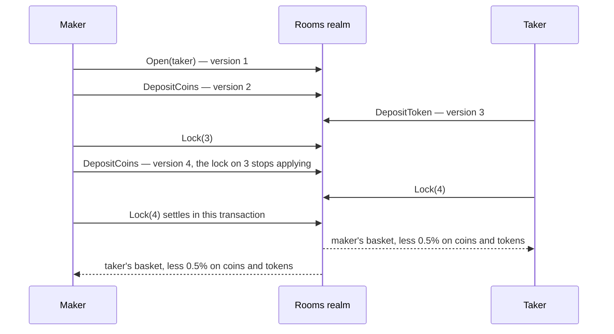

# Trade Window

Swap GNOT, GRC20 tokens and NFTs with one counterparty on Gno.land. Nothing moves until both wallets lock the same version.

[Practice without a wallet](https://tradewindow.xyz/practice) · [Room 1 on Onyx](https://onyx.testnets.gno.land/r/nym-tradewindow001/rooms:room/1) · [Settlement receipt](https://rpc.onyx.testnets.gno.land/tx?hash=0xC01FD8BA64FFB440632CF51D21736152540D5A52876BD58842765F73435A06B6) · [66-second walkthrough](https://dintsen.agency/assets/videos/trade-window/walkthrough.mp4) · [Gnome Tavern entry](https://dorahacks.io/build/52030)

[](https://dintsen.agency/assets/videos/trade-window/walkthrough.mp4)

## Verify it in one minute

1. Open [Room 1 in Gnoweb](https://onyx.testnets.gno.land/r/nym-tradewindow001/rooms:room/1). The realm renders `settled, version 4`.
2. Open the [settlement receipt](https://rpc.onyx.testnets.gno.land/tx?hash=0xC01FD8BA64FFB440632CF51D21736152540D5A52876BD58842765F73435A06B6), block 1,435,335. It holds the maker's `Locked` on version 4, a WUGNOT transfer of 1.99 to the maker and 0.01 to the treasury, and `Settled` with `feeBps=50`.
3. Read the [balance table](docs/ONYX-EVIDENCE.md). It lists all seven receipts, both wallets before and after, gas, and the taker's 1.0945 GNOT. GNOT moves through the bank module, so it has no transfer event in the receipt.

Room 1 shows why the version matters: the maker locked version 3, then added 0.1 GNOT. The room moved to version 4, the old lock stopped applying, and the swap only happened once both wallets locked version 4.

## How a trade works

1. The maker opens a room and invites one address, or leaves the seat open for whoever has the link. A room can settle for 10 minutes to 7 days.
2. Both sides deposit: GNOT sent with the call, any token from the gno.land GRC20 registry, or NFTs from GRC721 collections registered with the rooms realm, up to eight assets per side. The realm holds the deposits.
3. Every deposit, withdrawal or join raises the room's version by one. Getting ready (the realm's `Lock`) names a version, so a ready mark stops applying as soon as the room changes.
4. When the second side gets ready on the same version, the realm sends each side's deposits to the other in that transaction, less a 0.5% fee on coins and tokens.
5. Before that, either side can withdraw or cancel; after expiry anyone can cancel, and deposits only ever go back to their owners.



A maker can also name a price: `Offer` turns the room into a standing offer, and whoever sends exactly what it asks completes the trade with one `Fill` transaction. Ordinary rooms take only verified assets; open-market rooms take any registered asset and say so. The admin can pause new activity, set the fee for rooms opened later (at most 1%), move the treasury and verify assets (each counting a day later); it can never move a deposit.

Practice rooms run the same rules in the browser with play balances and a partner who answers, so the whole flow can be tried without a wallet.

## What the realm guarantees

| Guarantee | Where the chain enforces it |
| --- | --- |
| A lock applies only to the version its owner reviewed | [`Lock`](gno/realms/tradewindow/rooms/rooms.gno#L340) refuses any other version; [`bump`](gno/realms/tradewindow/rooms/rooms.gno#L533) raises it on every deposit, withdrawal and join |
| Both baskets move in one transaction | The second matching lock calls [`settle`](gno/realms/tradewindow/rooms/rooms.gno#L369); the room is marked settled before any asset leaves ([line 424](gno/realms/tradewindow/rooms/rooms.gno#L424)) |
| Coins are recorded only when they really arrive | [`DepositCoins`](gno/realms/tradewindow/rooms/rooms.gno#L225) accepts coins only from the signing account; [every other call refuses them](gno/realms/tradewindow/rooms/rooms.gno#L549) |
| Deposits only go back to their owners | [`Cancel`](gno/realms/tradewindow/rooms/rooms.gno#L397) returns each side to its owner; after expiry anyone can call it |
| The admin cannot touch deposits | The admin functions in [`admin.gno`](gno/realms/tradewindow/rooms/admin.gno), [`fee.gno`](gno/realms/tradewindow/rooms/fee.gno) and [`verified.gno`](gno/realms/tradewindow/rooms/verified.gno) pause, set fees for future rooms, move the treasury and verify assets; none of them moves a deposit |
| Settlement work is bounded | At most [eight assets per side](gno/realms/tradewindow/rooms/rooms.gno#L56) |

The threat model and the attacks the tests reproduce are in [docs/SECURITY-REVIEW.md](docs/SECURITY-REVIEW.md). Every exported function and its refusals: [docs/CONTRACT.md](docs/CONTRACT.md).

## Deployed on Onyx

| Realm | Package path | Holds assets |
| --- | --- | --- |
| [Rooms](https://onyx.testnets.gno.land/r/nym-tradewindow001/rooms) | `gno.land/r/nym-tradewindow001/rooms` | Yes: deposits until settlement or cancellation |
| [Board](https://onyx.testnets.gno.land/r/nym-tradewindow001/board) | `gno.land/r/nym-tradewindow001/board` | No: public listings only |

Chain `onyx-1`, RPC `https://rpc.onyx.testnets.gno.land:443`. Room 1 proves GNOT and GRC20 settlement on Onyx; NFT settlement is covered by realm tests and will get its own Onyx receipt.

## Repository

| Path | What |
| --- | --- |
| `gno/realms/tradewindow/rooms` | The rooms realm: custody, versions, locks, settlement, offers, fees, verified assets, JSON reads, gnoweb page |
| `gno/realms/tradewindow/board` | The board realm: public listings that hold no assets |
| `apps/web` | The site: Next.js 16, Adena wallet, practice rooms, three.js home and trade scenes |
| `scripts/gno` | Deploy, name registration, realm tests, local end-to-end run |
| `services/backend-go` | Go service that stores private deal requests |
| `docs/design/DIRECTION.md` | Design direction: glass panes at night |
| `AGENTS.md` | Rules and conventions for anyone, human or agent, working here |

## Run it

```bash
cd apps/web
npm ci
npm run dev
```

Without realm paths in the environment, `/trade` and `/board` say the realms are not live yet, and practice rooms work in full.

## Test it

```bash
scripts/gno/test-contracts.sh          # 49 rooms tests and 4 board tests (gno from the chain/mainnet branch)
scripts/gno/e2e-localnet.sh            # real transactions on a throwaway local chain

cd apps/web
npm run lint && npm run typecheck && npm test && npm run build
npx playwright test e2e/practice.spec.ts
```

`apps/web/e2e/README.md` describes the browser test of a full two-party trade on a local chain.

## Deploy the realms

The owner deploys with their own key; see `docs/deploy-onyx.md`.

```bash
scripts/gno/deploy.sh <your-gnokey-key> <your-g1-address-or-nym-name> onyx
```

The script prints the five `NEXT_PUBLIC_*` values to set for the site.

## Roadmap

2027: OTC classifieds for tokens, NFTs and bundles; an accepted listing that opens a private room with messaging; a pilot with an independent community; then one cross-chain route on testnets. Quarter by quarter, with the evidence each step must produce: [docs/ROADMAP.md](docs/ROADMAP.md).

## About this repository

This is the canonical repository and the source of the [Gnome Tavern release](https://github.com/ddintsen/trade-window/releases/tag/gnome-tavern-2026). The default branch, `hackathon/gnome-tavern-2026`, is the code submitted to the hackathon. It is a fork of [dintsen/trade-window](https://github.com/dintsen/trade-window), the same author's earlier account, which holds the July 2026 off-chain prototype.

## License

Apache 2.0, see `LICENSE`.
