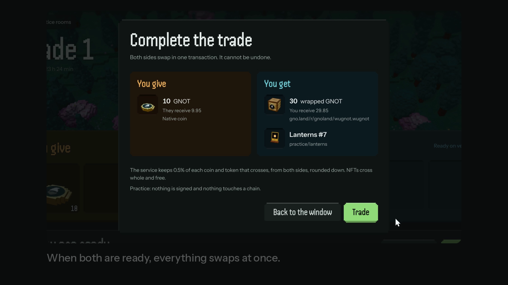

# Trade Window

Two people agree on a trade, lock the same offer, and exchange GNOT, GRC20 tokens, or NFTs in one transaction on Gno.land.

[View rooms on Onyx](https://onyx.testnets.gno.land/r/nym-tradewindow001/rooms) · [Open a practice room](https://tradewindow.xyz/practice) · [Watch the 66-second walkthrough](https://dintsen.agency/assets/videos/trade-window/walkthrough.mp4) · [Read the contract](docs/CONTRACT.md)

[](https://dintsen.agency/assets/videos/trade-window/walkthrough.mp4)

The public app has a wallet-free practice room. The rooms and board realms have been exercised with transactions on a local Gno chain. The rooms realm is live on Onyx. The board deployment is pending.

## How a trade works

1. The maker opens a room and invites one address, or leaves the seat open
   for whoever has the link. A room can settle for 10 minutes to 7 days.
2. Both sides deposit: GNOT sent with the call, any token from the gno.land
   GRC20 registry, or NFTs from GRC721 collections registered with the rooms
   realm, up to eight assets per side. The realm holds the deposits.
3. Every deposit, withdrawal or join raises the room's version by one.
   Getting ready (the realm's `Lock`) names a version, so a ready mark stops
   applying as soon as the room changes.
4. When the second side gets ready on the same version, the realm sends each
   side's deposits to the other in that transaction, less a 0.5% fee on
   coins and tokens.
5. Before that, either side can withdraw or cancel; after expiry anyone can
   cancel, and deposits only ever go back to their owners.

A maker can also name a price: the other side accepts it with one
transaction that puts the wanted assets in and settles. Ordinary rooms take
only verified assets; open-market rooms take any registered asset and say
so. The admin can pause new activity, set the fee for rooms opened later
(at most 1%), move the treasury and verify assets (each counting a day
later); it can never move a deposit.

Practice rooms run the same rules in the browser with play balances and a
partner who answers, so the whole flow can be tried without a wallet.

## Repository

| Path | What |
| --- | --- |
| `gno/realms/tradewindow/rooms` | The rooms realm: custody, versions, locks, settlement, JSON reads, gnoweb page |
| `gno/realms/tradewindow/board` | The board realm: public listings that hold no assets |
| `apps/web` | The site: Next.js 16, Adena wallet, practice rooms, three.js home and trade scenes |
| `scripts/gno` | Deploy, name registration, realm tests, local end-to-end run |
| `services/backend-go` | Go service that stores private deal requests |
| `docs/design/DIRECTION.md` | Design direction: glass panes at night |
| `AGENTS.md` | Rules and conventions for anyone, human or agent, working here |

## Run it

```bash
cd apps/web
npm ci
npm run dev
```

Without realm paths in the environment, `/trade` and `/board` say the realms
are not live yet, and practice rooms work in full.

## Test it

```bash
scripts/gno/test-contracts.sh          # realm tests (gno from the chain/mainnet branch)
scripts/gno/e2e-localnet.sh            # real transactions on a throwaway local chain

cd apps/web
npm run lint && npm run typecheck && npm test && npm run build
npx playwright test e2e/practice.spec.ts
```

`apps/web/e2e/README.md` describes the browser test of a full two-party trade
on a local chain.

## Deploy the realms

The owner deploys with their own key; see `docs/deploy-onyx.md`.

```bash
scripts/gno/deploy.sh <your-gnokey-key> <your-g1-address-or-nym-name> onyx
```

The script prints the five `NEXT_PUBLIC_*` values to set for the site.

## Status

- Realms: complete, tested, scanned with the gno audit pattern harness, and
  exercised with real transactions on a local chain. Rooms are live on Onyx.
  The board realm is awaiting publication.
- Site: complete for rooms, practice rooms, the board, private requests, and
  the how-it-works and contract pages.
- Names: the realms live under the gno.land domain at
  `gno.land/r/<namespace>/rooms` and `.../board`. A `tradewindow.gno` name
  will be registered once GNS is available beyond the Pearl testnet.

## License

Apache 2.0, see `LICENSE`.
